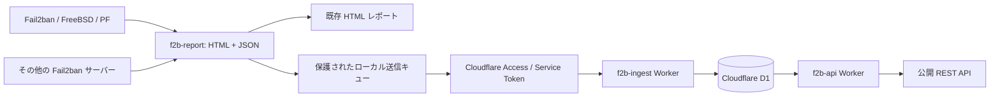

# f2b-api

Fail2ban の収集結果を Cloudflare Workers と D1 に集約し、IPv4・IPv6 の検索、統計、IP フィードを提供します。既存の HTML レポートは [f2b-report](https://github.com/haturatu/f2b-report) で継続します。

記録は各収集元の Fail2ban による観測結果です。IP が記録されていることだけで悪意を断定するものではありません。

## 構成



公開 API は `https://f2b.0xhw.com`、収集 API は `https://f2b-ingest.0xhw.com` です。Workers は 2 個、D1 は 1 個を使用します。Containers、KV、R2、Durable Objects はアプリケーションの実行には不要です。インフラの既存 Terraform state・設定保存は、別の管理基盤が担当します。

## 静的ドキュメントサイト

[ルートページ](https://f2b.0xhw.com/)には、Hugo と Hextra v0.13.0 で生成した静的サイトを配信します。公開用の遮断ポリシー、スキャナーの検知条件、サービス別の期間・回数、API の使い方、観測データの制約を説明します。

Hugo の設定・本文・テーマ依存は `site/`、アセットの生成は `scripts/build-site.mjs` で管理します。生成物は Git に含めず、ビルド時に既存 Worker へ同梱するため、サイト用のサーバーやストレージを追加しません。サイトの画面・CSS・検索機能は同じホストから配信します。

`/health` は JSON のサービス情報、`/docs` は Swagger UI、`/v1/*` は既存 API を提供します。公開用の説明には管理用ネットワークや認証情報を含めません。

## 公開 API

[API ドキュメント](https://f2b.0xhw.com/docs)は Swagger UI で表示し、公開 GET API をブラウザーから実行できます。[OpenAPI JSON](https://f2b.0xhw.com/openapi.json)は同じ Worker から配信します。サーバー URL は相対パスのため、ドキュメントを開いたホストにリクエストします。

Swagger UI の CSS と JavaScript は、バージョンを固定して jsDelivr から読み込み、SRI で整合性を検証します。CDN を利用できない場合も OpenAPI JSON を直接取得できます。画面と仕様のキャッシュ期間は 1 時間です。

| メソッド・パス | 用途 |
| --- | --- |
| `GET /health` | サービス情報 |
| `GET /v1/lookup?ip=...` | 同じ IP の収集元、Jail、日時、状態、国、ASN |
| `GET /v1/ips` | ページング付き観測一覧 |
| `GET /v1/stats` | 有効な観測とユニーク IP の統計 |
| `GET /v1/sources` | 公開用の収集元ラベル、Jail、更新状態 |
| `GET /v1/feed.txt` | 重複を除いた、現在有効な IP のテキスト一覧 |

公開 API は読み取り専用です。`/v1/ips` は `source`、`jail`、`country`、`asn`、`active`、`limit`、`cursor` を受け付けます。既定では更新が新しい有効な BAN を返し、`active=false` で解除済み、`active=all` で全履歴を返します。

一覧は観測単位なので、同じ IP に複数の収集元や Jail が存在します。`first_seen` は初回収集時刻、`last_seen` は最後に確認した収集時刻です。日時は Unix 秒で返します。

`/v1/ips` のページサイズは既定 100、最大 500 です。レスポンスの `next_cursor` を次のリクエストに渡します。フィードの上限は既定 1,000、最大 5,000 です。`X-Truncated: true` の場合は `X-Next-Cursor` を `cursor` に指定して続きを取得してください。

最終収集から 48 時間以上経過した Jail は `stale=1` とし、現在有効な一覧・統計・フィードから除外します。`lookup` と `active=all` では状態を確認できます。観測履歴は保持し、収集元の停止を解除イベントとは扱いません。

## 収集 API

`POST /v1/ingest/snapshot/{source}` は収集ドメインの割り当てられたパスだけで利用できます。Cloudflare Access の Service Auth ポリシーが認証し、Worker は `ctx.access.aud` の検証済み Access アプリケーション AUD と、設定上の収集元・Jail の範囲を照合します。ユーザー DB、ログイン画面、パスワード保存、JWT 発行基盤は持ちません。

認証ヘッダーは `CF-Access-Client-Id` と `CF-Access-Client-Secret` です。収集元ごとに独立した Service Token と Access アプリケーションを作成し、専用のパスでその Token だけを許可します。一般ユーザー向け identity の取得や JWT の解析を行いません。`workers.dev` とプレビュー URL は両 Worker で無効です。Access コンテキストがない呼び出しも Worker 側で拒否します。

入力は [収集 API の OpenAPI 仕様](openapi-ingest.json)を参照してください。最大サイズは 2 MiB、IP は最大 10,000 件です。プライベート・予約アドレスを拒否し、IPv4-mapped IPv6 と IPv6 表記を正規化します。組織名などのメタデータとクエリーも検証し、SQL はバインド変数を使用します。

IP とメタデータの一覧が同じなら、収集元は直前に受け取った `snapshot_hash` の heartbeat だけを送信できます。変更時には完全なスナップショットを送信します。D1 は追加、解除、再検出、メタデータ変更だけを観測テーブルへ反映し、変化のない観測行は書き直しません。heartbeat は Jail の収集状態だけを更新します。

D1 の batch 内で状態と差分をまとめて反映します。書き込みトークンと直前の状態を使い、並行リクエストでスナップショットが混ざることを防ぎます。古い時刻や同時刻の異なる内容は 409 です。同じ内容の再送は冪等に処理します。送信キュー、再送、非公開 IP の除外は `f2b-output/collector/upload.py` が担当します。

定期スナップショットは、収集時点の BAN 一覧です。収集と収集の間に開始・終了した BAN や、その正確なイベント時刻は復元できません。

## 開発と検証

Hugo extended 0.164.0 と Go（`site/go.mod` のバージョン）を用意します。テーマは Hugo Modules でバージョンを固定し、チェックサムを管理します。`typecheck`・`test`・`build` の各コマンドはサイトを生成してから実行します。

```sh
npm ci
npm run typecheck
npm test
npm run build
```

ローカル開発用の `wrangler.jsonc` はダミーの DB ID を使用します。

```sh
npx wrangler d1 migrations apply f2b-api-local --local
npm run dev
```

テストは実際のローカル D1 ランタイムを使用し、認証の迂回防止、収集元の分離、IP 検証、再送・heartbeat、空の一覧、解除と再検出、競合、検索、ページング、統計、古い収集元の除外を確認します。

## デプロイ

Workers、D1、Access、カスタムドメインは既存の `cftf/stacks/f2b` で管理します。Hugo の本文・設定・ビルド処理を変更した場合も、`npm run build` でサイトを同梱し、`dist/api.js` と `dist/ingest.js` を非公開設定リビジョンに格納し、専用の `f2b` ターゲットで plan と apply を実行します。既存 Worker の state と分離しています。

`migrations/0001_initial.sql` を対象 D1 に適用してから収集を開始します。DB ID、アカウント ID、認証用 Secret、D1 の実データやバックアップはこのリポジトリに保存しません。CI は認証情報を使わずテストとビルドを実行します。デプロイと状態の管理は `cftf` の既存の非公開実行基盤が担当します。

Service Token の標準有効期間は 1 年です。期限前にインフラ管理側で更新し、各サーバーのモード `0600` の認証設定を更新します。

## 無料枠とキャッシュ

Workers と D1 の無料枠での小規模運用を想定しています。課金プランの契約はこのアプリケーションから変更しません。無料プランの上限に達した場合、API が一時的に利用できなくなる場合があります。

公開 API は Rate Limiting binding でクライアント IP ごとに 1 分 120 回を目安に制限し、超過時は 429 と `Retry-After` を返します。この制限は Cloudflare 拠点ごとの概算です。API 用ホストだけ Browser Integrity Check をスキップし、一般的な HTTP クライアントを受け付けます。収集元の Access 認証は継続します。

公開レスポンスはエッジキャッシュを使用します。統計は 15 分、フィードは 5 分、その他は 1 分です。IP へのインデックスとページサイズの上限で読み取りを制限し、heartbeat と差分更新で書き込みを減らします。アクセスが複数拠点に分散した場合やキャッシュが無効な場合もあるため、D1 の `rows_read`、`rows_written`、容量を確認してください。

- [Workers の制限](https://developers.cloudflare.com/workers/platform/limits/)
- [D1 の料金と無料枠](https://developers.cloudflare.com/d1/platform/pricing/)
- [Workers の Cloudflare Access](https://developers.cloudflare.com/workers/configuration/cloudflare-access/)
- [D1 batch のトランザクション](https://developers.cloudflare.com/d1/worker-api/d1-database/)

## ライセンス

[BSD 2-Clause License](LICENSE)。Copyright (c) 2026, haturatu。

テーマと検索ライブラリーのライセンスは `site/static/licenses/` に保持し、サイトからも参照できます。
